# Vision Smash Code 🎨

  

A visual enhancement extension for VS Code that injects life into your coding experience! Provides mouse/cursor trails, typing effects, smooth window animations, and beautiful gradient themes.

🌐 English | [中文文档](https://github.com/Jenlybein/vision-smash-code/blob/main/README-zh.md)

---

## 🚀 Quick Start

### 📋 Prerequisites

> ⚠️ **Important:** This extension cannot modify editor styles by itself. It relies on a third-party injection backend to load the CSS/JS it generates, and the only supported backend is **[Custom UI Style](https://marketplace.visualstudio.com/items?itemName=subframe7536.custom-ui-style)** (`subframe7536.custom-ui-style`).

The backend is **not** a hard dependency: if it is missing, this extension shows an error with an install action instead of silently doing nothing, and it writes neither settings nor generated files until the backend is available.

### 📝 Enable Steps

1. Open VS Code Extension Marketplace
2. **Install the injection backend:** `Custom UI Style` (by subframe7536)
3. **Install this extension:** Search and install `Vision Smash Code` (by gentlybeing)
4. **Open Settings**
   - Press `Ctrl+Shift+P` (Windows/Linux) or `Cmd+Shift+P` (macOS) to open the Command Palette
   - Type `Vision Smash Code: OpenSettings` and run
5. **Enable features:** Toggle the features you want in the settings page
6. **Apply changes**
   - The extension calls the backend's reload command for you; if the UI does not update, run `Custom UI Style: Reload` from the Command Palette manually
   - If `custom-ui-style.reloadWithoutPrompting` is `false` (the default), a notification prompt appears first — confirm it to let the backend reload
   - On Windows, if nothing changes, fully quit VS Code (close **all** windows) and start it again; a plain "Reload Window" is sometimes not enough
   - Wait for VS Code to restart and apply all effects

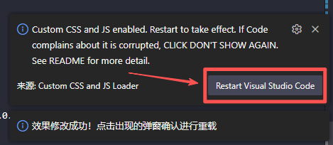

### ⬆️ Upgrading from 1.2.x

This version no longer supports Custom CSS and JS Loader. Uninstall it (run its restore action if it offers one), and remove this extension's entries from `vscode_custom_css.imports` in `settings.json`. Then install Custom UI Style.

### ⚙️ Configuration Options

| Setting | Default | Description |
| --- | --- | --- |
| `visionSmashCode.base.cursor` | `false` | Enable cursor trail effects |
| `visionSmashCode.base.animations` | `false` | Enable window animation effects |
| `visionSmashCode.base.gradient` | `false` | Enable gradient theme effects |
| `visionSmashCode.base.word` | `false` | Enable typing explosion effects |
| `visionSmashCode.base.mouse` | `false` | Enable mouse tail effects |

### 🔌 Injection backend

This extension generates CSS/JS files and asks **Custom UI Style** to inject them. It is the only supported backend: both loaders used to patch the same `workbench.html` and corrupt each other's backups, so the dual-backend switch was removed.

**What this extension writes:** only its own entries in `custom-ui-style.external.imports`. An entry counts as "its own" only if its path ends in `src/<this extension's asset directory>/<asset file>`, so **your own entries in that list are never modified or deleted.**

**After changing any setting:**

- Run `Custom UI Style: Reload` from the Command Palette. The backend only re-reads `custom-ui-style.external.imports` on reload.
- `custom-ui-style.reloadWithoutPrompting` defaults to `false`; the backend shows a notification prompt you must confirm before it reloads.
- On Windows, a plain "Reload Window" is sometimes not enough: fully quit VS Code by closing **all** windows, then start it again.
- If `custom-ui-style.external.loadStrategy` is set to `"disable"`, **all** external resources are ignored — including this extension's imports. Set it back to the default `"refetch"` (or `"cache"`).

**Not verified on a real editor:** Custom UI Style loads local `.js` files as **ES modules** (`<script type="module">`), while the effects in this extension are classic scripts. Whether the three JS effects (cursor trail, mouse trail, typing explosion) actually run under ESM semantics **has not been verified in a real VS Code instance**. The two CSS effects are expected to work. To check, open `Developer: Toggle Developer Tools` → Console after reloading and look for module/scope errors.

### ❓ Why does VS Code say the installation is "corrupt"?

This is normal! Custom UI Style changes files inside the VS Code installation directory to inject styles. It keeps backups with a `.custom-ui-style` suffix and suppresses the corruption notice itself. **It does not affect any VS Code features or your experience.**

To revert every change made by the backend, run `Custom UI Style: Rollback` from the Command Palette.

---

## ✨ Features

All features can be enabled/disabled independently.

### 🌈 Gradient Theme Enhancements

Add beautiful gradients to various VS Code UI elements for a more vivid experience.

| Feature | Description | Preview |
| --- | --- | --- |
| **Top active tab gradient** | Gradient color for the active editor tab | 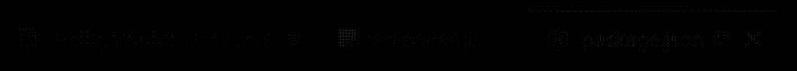 |
| **Line number rainbow glow** | Rainbow glow for line numbers | 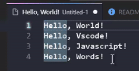 |
| **Command palette gradient** | Gradient background for command palette (`Ctrl+Shift+P`) | 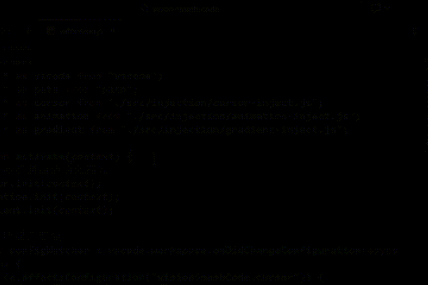 |
| **Editor hover glass effect** | Frosted glass effect for hover tooltips | 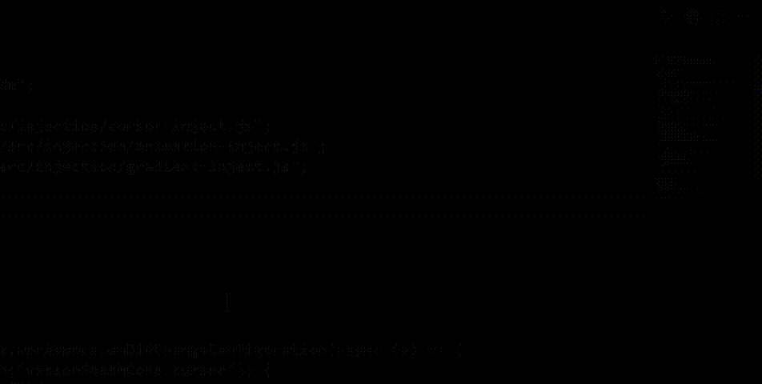 |
| **Text subtle gradients** | Subtle gradient for text | 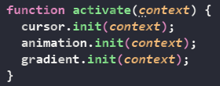 |
| **Text glow** | Glowing text effect (off by default) | 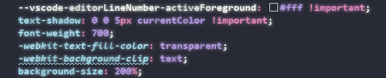 |
| **Git change icon gradients** | Gradient for Git change indicators | Built-in |

### 🪟 Window Animations

Smooth animations for VS Code UI interactions, making operations more fluid and natural.

| Feature | Description | Preview |
| --- | --- | --- |
| **Command palette expand/collapse** | Smooth animation when opening/closing command palette | 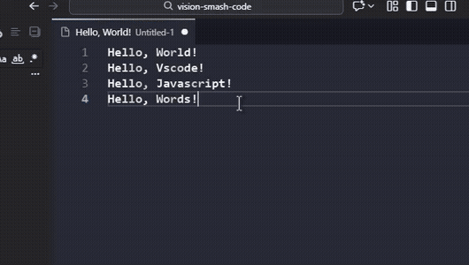 |
| **List item fade-in** | List items fade in when scrolling | 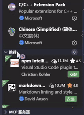 |
| **Active item highlight** | Smooth highlight transition for list items | 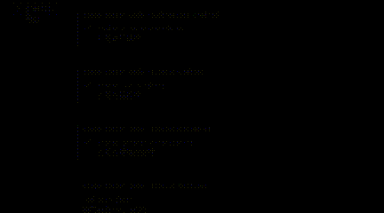 |
| **Smooth mode transitions** | Smooth transitions for UI changes | 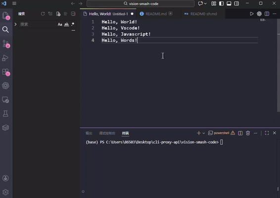 |

### 🖱️ Mouse Trail Effects

Add colorful mouse trails for a more dynamic coding experience. Five built-in styles (customizable):

| Style | Description | Effect |
| --- | --- | --- |
| **Dots** | Small dot trail | 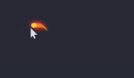 |
| **Beam** | Continuous beam | 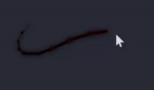 |
| **Ribbon** | Ribbon-like trail | 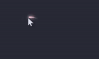 |
| **Smoke** | Smoke diffusion | 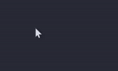 |
| **Electric** | Electric flicker | 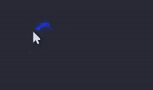 |

### 🆚 Typing Effects

Add visual effects to text input for a more fun typing experience.

| Effect | Demo |
| --- | --- |
| Zoom | 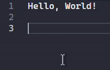 |
| Gravity | 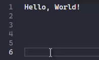 |
| Drift | 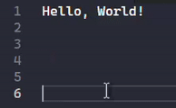 |
| Fixed (with random angle) | 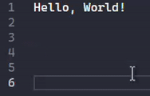 |

### 🟪 Cursor Trail Effects

Smooth trailing animation for the cursor, making movement more lively.

**Features:**
- ✨ Smooth cursor tracking animation
- 🎨 Customizable trail color
- 👻 Supports opacity and glow
- ⚡ Multiple animation durations and easing
- 🎯 Can be enabled/disabled independently

---

## 📦 Installation

### From VS Code Marketplace (Recommended)

1. Open VS Code
2. Press `Ctrl+P` (Windows/Linux) or `Cmd+P` (macOS) to open Quick Open
3. Type `ext install gentlybeing.vision-smash-code`
4. Click the extension in the results
5. Click **Install**

**Or**

1. Click the **Extensions** icon in the sidebar (or press `Ctrl+Shift+X`)
2. Search for `Vision Smash Code`
3. Find the version by `gentlybeing`
4. Click **Install**

---

## 🙏 Acknowledgements

Thanks to the following projects for inspiration and reference:

| Project | Purpose | Link |
| --- | --- | --- |
| **VS Code** | Powerful code editor | [code.visualstudio.com](https://code.visualstudio.com/) |
| **VSCode Animations** | Window animation inspiration | [GitHub](https://github.com/BrandonKirbyson/VSCode-Animations) |
| **Neovide Cursor** | Cursor effect inspiration | [GitHub](https://github.com/30d98f9b2/Neovide-Cursor) |
| **Gradient Theme** | Gradient beautification | [GitHub](https://github.com/shaobeichen/gradient-theme) |
| **Custom UI Style** | Style injection solution | [GitHub](https://github.com/subframe7536/vscode-custom-ui-style) |

## 📄 License

This project is licensed under **GPL-3.0**. See [LICENSE](../LICENSE.txt) for details.

## ⭐ Support

If you like this project, please:
- Star it on GitHub
- Share with other developers
- Mention it on social media
- Consider sponsoring the developer (if possible)

---

**Enjoy coding with style! 🎨✨**
